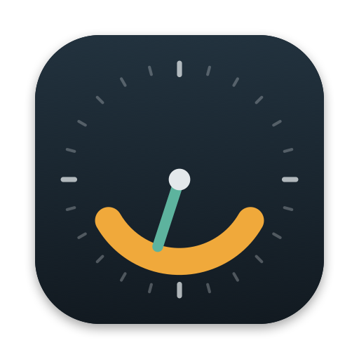

# Ur

*Ur* is Norwegian for clock. It's a keyboard-first macOS app for tracking how your work day is spent, and which projects the hours go to.



This repo is where Ur is released. From version 2.0 the app is a rewrite, and its source is no longer public. The code here is Ur 1, the Swift app, as it was at the last release; the [`swift-final`](https://github.com/alexandernygard/ur/tree/swift-final) tag marks it.

## Install

You need an Apple Silicon Mac with macOS 14 or later.

**With Homebrew:**

```sh
brew install --cask alexandernygard/tap/ur
```

Update later with `brew upgrade --cask ur`.

**Without Homebrew:** download `Ur.zip` from the [latest release](https://github.com/alexandernygard/ur/releases/latest), unzip it and drag `Ur.app` into Applications.

**The first time you open it**, macOS says it can't verify the developer, because Ur isn't signed with a paid Apple developer account. Click **Done**, then open **System Settings → Privacy & Security**, scroll down to the message about Ur and click **Open Anyway**. You only need to do this once.

## Coming from Ur 1

Ur 2 picks up where Ur 1 left off. On first launch it reads Ur 1's data and saves it in its own file next to it, so the old file is never changed.

What's different:

- A work day isn't started or ended any more. It runs from your first entry to your last.
- Each entry has a list of notes, one per task, in place of one free-text note. Lines in an old note become separate items.
- The Timesheet shows each project's tasks per day, and a day-by-day section to copy into a time-keeping system.
- Undo takes back one step and only what that step changed.

## Data

Everything is stored locally in `~/Library/Application Support/Ur/ur-2.json`, with one backup a day (the last 14 are kept) in `Backups/`. Ur 1's `ur.json` stays in the same folder, as it was on the day you upgraded.

## Ur 1

To build the Swift app from source (needs Swift; the Command Line Tools are enough):

```sh
gh repo clone alexandernygard/ur -- --branch swift-final
cd ur && ./install.sh
```

Ur 1 ran on Intel Macs too; [version 1.2.0](https://github.com/alexandernygard/ur/releases/tag/v1.2.0) is the last release for them.
