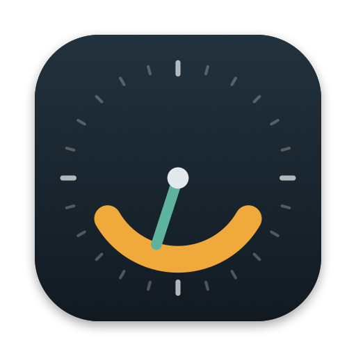

# Ur

*Ur* is Norwegian for clock. It's a keyboard-first macOS app for tracking how your work day is spent: when it starts, when it ends, and which projects the hours in between go to.



## Install

You need macOS 14 or later, on Apple Silicon or Intel.

**With Homebrew:**

```sh
brew install --cask alexandernygard/tap/ur
```

Update later with `brew upgrade --cask ur`.

**Without Homebrew:** download `Ur.zip` from the [latest release](https://github.com/alexandernygard/ur/releases/latest), unzip it and drag `Ur.app` into Applications.

**The first time you open it**, macOS says it can't verify the developer, because Ur isn't signed with a paid Apple developer account. Click **Done**, then open **System Settings → Privacy & Security**, scroll down to the message about Ur and click **Open Anyway**. You only need to do this once.

**From source** (needs Swift; the Command Line Tools are enough):

```sh
xcode-select --install          # only if you don't have Swift yet
gh repo clone alexandernygard/ur
cd ur && ./install.sh
```

`install.sh` builds a release version, puts `Ur.app` in `/Applications` (or `~/Applications`), and opens it. To update later, run `git pull && ./install.sh`.

## How it works

- **Start and end your day** with ⌘D. Both times are drawn in amber on the calendar and in stats. Drag the amber line to change them, or right-click anywhere on a day to start or end it at that time. Starting a timer also starts the day automatically (you can turn this off in Settings). The day always covers its entries: it starts no later than your first entry and ends no earlier than your last, so time you fill in for the morning moves the start back.
- **Track the present** with the round button beside the clock (⌘↩): it stops the timer, or picks the last entry back up. Start a particular project with ⌘1–⌘9, the project chips, or the menu bar. Switching projects stops the previous timer.
- **Fill in the past** by dragging on the timeline, clicking an unallocated gap, or pressing ⌘N. New time replaces whatever it overlaps: while you drag, the blocks it would replace fade, and the editor says what will be cut. A running timer is never removed this way; it picks up after the new time. Press Esc mid-drag to put things back.
- **Undo** anything with ⌘Z: moves, resizes, deletes, starting and stopping, and changes to the day.
- **Snap into place**: while you drag, a block's edges snap to the edges of other blocks, the start and end of the day, and the current time, and a green guide line shows what it snapped to. Otherwise times snap to the grid set in Settings. Hold ⌥ to place to the minute.
- **Zoom** the calendar by pinching, or with ⌘+, ⌘− and ⌘0. The time under your fingers stays put.
- **Resume** an entry with the play button that appears when you hover a block, from its right-click menu, or with ⌘R (the selected entry, or the last one). If it's the last thing you did today, its menu also offers *Resume from 14:30*, which continues the same block and counts the break.
- **Plan the future** by adding entries later in the day. They appear dashed and don't count as tracked until the time has passed.
- **Command bar** (⌘K, or ⌃⌥Space from any app):
  - `design` starts Design
  - `design 9-11:30 review` logs 09:00–11:30 with the note "review"
  - `design 1h30` logs the last hour and a half
  - an unknown name creates the project and starts it

## Keyboard shortcuts

| Keys | Action |
|---|---|
| ⌘↩ | Stop the timer, or resume the last entry (the big round button) |
| ⌘1 – ⌘9 | Start or stop project 1–9 (order set in Projects) |
| ⌘K / ⌃⌥Space | Command bar / command bar from anywhere |
| ⌘. | Stop timer |
| ⌘R | Resume the selected entry, or the last one |
| ⌘D | Start / end / resume the work day |
| ⌘N | Add time |
| ⌘E | Edit selected or running entry |
| ⌘⌫ | Delete selected entry |
| ⌘Z, ⇧⌘Z | Undo, redo |
| ⌘T, ⌘[, ⌘] | Today, previous, next |
| ⌘+, ⌘−, ⌘0 | Zoom the calendar in, out, back to normal |
| ⌥⌘1 – ⌥⌘4 | Calendar, Timesheet, Stats, Projects |
| ⌃⌘1 – ⌃⌘3 | Calendar shows one day, workdays, or the full week |
| ⌘/ | Shortcut list |

## Views

- **Calendar**: the running clock, the day's start and end, project chips, and an editable timeline. Switch between one day, the five workdays, or the full week; every column can be edited the same way, and blocks can be dragged from one day to another. Beside it are a month calendar (click a day or a week number to go there) and totals for what's on screen, with any unallocated gaps.
- **Timesheet**: hours per project per day for the week, with group subtotals and time at work.
- **Stats**: week, month or year view of tracked hours, days worked, average day length, average start and end times, and how much of the work day was allocated. Charts show hours per day by project, the span of each work day, project share, and time of day. A *Past year* graph, like GitHub's contribution graph, shades each day by how much you tracked, with a strip per project showing its busy and quiet weeks; click a day to open it. *Show* narrows the whole page to one group or project. You can export entries or work days as CSV.
- **Projects**: each group, such as a client, is a card with its projects and their combined time. Drag a project to reorder it (which sets the ⌘ numbers) or into another group, and drag a group by its handle to reorder groups. Add a project right inside a group, and double-click a name to rename it. Each project shows its last 12 weeks, when you last tracked it and its total. Click one to open it on the side, where you can change its colour and group, start a timer, archive or delete it. Archived projects leave the chips, shortcuts and command bar but keep their time; they sit in a folded Archived list where you can restore them. Groups also add up in the Day, Week and Stats breakdowns, where a group can be folded to show only its total. Moving, adding and deleting projects and groups can be undone with ⌘Z.

## Data

Everything is stored locally in `~/Library/Application Support/Ur/ur.json`, with a daily backup (the last 14 are kept) in `Backups/`. Settings → Show in Finder opens the folder.

## Development

```sh
./scripts/dev.sh            # build and open "Ur Dev" from your working copy
./scripts/dev.sh --copy-data   # same, starting from a copy of Ur's data
swift build                 # debug build
./scripts/build-app.sh      # bundle build/Ur.app
swift scripts/make-icon.swift Resources/AppIcon.icns   # regenerate the icon
```

Ur Dev is a separate app (bundle ID `no.nygard.ur.dev`) that runs next to the installed Ur. It's installed in `~/Applications`, keeps its data in `~/Library/Application Support/Ur Dev`, shows DEV in the menu bar, and opens its command bar with ⌃⌥⇧Space. `swift run` also uses the Ur Dev data folder.

To publish a new version, push a tag: `git tag v1.2.0 && git push origin v1.2.0`. The Release workflow builds a universal app, attaches `Ur.zip` to a GitHub release and updates the Homebrew cask. `UNIVERSAL=1 ./scripts/build-app.sh` makes the same universal build locally.

`UR_DATA_DIR=/tmp/ur-demo` runs the app against a different data folder. `UR_SNAPSHOT=/some/dir` renders each screen to PNG and then quits.
